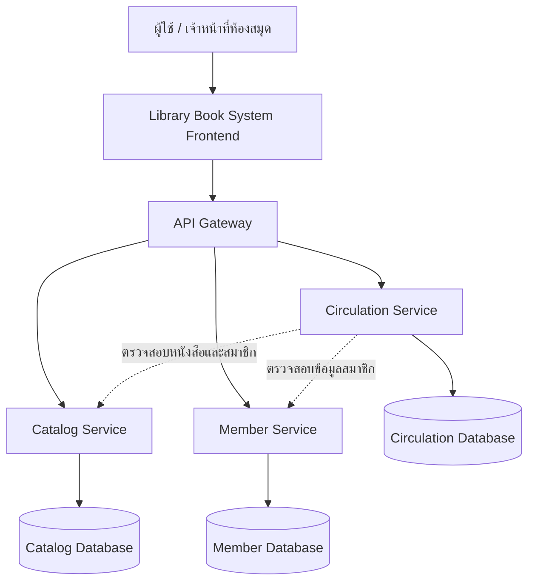

# ออกแบบสถาปัตยกรรม Microservices ของระบบ Library Book System

## 1. การแบ่งบริการ (Service Decomposition)

ระบบ Library Book System ใช้แนวคิด Bounded Context แบ่งบริการตามความรับผิดชอบทางธุรกิจของระบบห้องสมุด เพื่อให้แต่ละบริการดูแลข้อมูลและกฎการทำงานของตนเองได้อย่างชัดเจน

| บริการ | ความรับผิดชอบ | Endpoint หลัก |
|---|---|---|
| API Gateway | เป็นจุดเข้าถึง API จาก Frontend และส่งต่อ Request ไปยังบริการที่เกี่ยวข้อง พร้อมจัดการการตรวจสอบสิทธิ์ส่วนกลางเมื่อมีการเพิ่ม Authentication | `/api/books/*`, `/api/members/*`, `/api/loans/*` |
| Catalog Service | จัดการข้อมูลหนังสือ ผู้แต่ง และหมวดหมู่ รวมถึงค้นหาและดูรายละเอียดหนังสือ | `GET /api/books`, `GET /api/books/:id`, `POST /api/books`, `PUT /api/books/:id`, `DELETE /api/books/:id` |
| Member Service | จัดการข้อมูลสมาชิกห้องสมุด เช่น การเพิ่ม แก้ไข ลบ และค้นหาสมาชิก | `GET /api/members`, `POST /api/members`, `PUT /api/members/:id`, `DELETE /api/members/:id` |
| Circulation Service | จัดการการยืม คืน ประวัติการยืม และข้อมูลกำหนดคืนหนังสือ โดยตรวจสอบข้อมูลสมาชิกและหนังสือที่เกี่ยวข้อง | `POST /api/loans`, `PUT /api/loans/:id/return`, `GET /api/members/:id/loans` |

หมายเหตุ: ตารางนี้เป็นการออกแบบเป้าหมายสำหรับสถาปัตยกรรมของระบบ ต้องตรวจสอบชื่อ Path และ Method กับโค้ด Backend จริงก่อนนำไปใช้เป็นเอกสาร API ฉบับสุดท้าย

### เหตุผลในการแบ่งบริการ

1. **Catalog Service** มีขอบเขตด้านการจัดการทรัพยากรห้องสมุด ไม่ควรรับผิดชอบกฎการยืมและคืนหนังสือ
2. **Member Service** มีขอบเขตด้านข้อมูลและการดูแลสมาชิก ซึ่งมีวงจรการทำงานต่างจากข้อมูลหนังสือ
3. **Circulation Service** มีขอบเขตด้านธุรกรรมการยืมและคืน ซึ่งต้องตรวจสอบความสัมพันธ์ระหว่างสมาชิก หนังสือ และรายการยืม
4. **API Gateway** เป็นจุดเข้าถึงระบบและตัวกลางส่งต่อ Request ไม่ใช่ Business Service ตามแนวคิด Bounded Context

การแบ่งดังกล่าวช่วยลดการผูกติดกันของความรับผิดชอบ ทำให้แต่ละบริการพัฒนาและทดสอบแยกกันได้ โดยต้องกำหนดสัญญา API ระหว่างบริการให้ชัดเจน

## 2. แผนภาพสถาปัตยกรรม

คำอธิบาย:

- ผู้ใช้ทำงานผ่าน Frontend ซึ่งส่ง Request ไปยัง API Gateway
- API Gateway เลือกส่ง Request ไปยังบริการตาม Path ที่กำหนด
- Catalog Service ดูแลข้อมูลหนังสือและหมวดหมู่
- Member Service ดูแลข้อมูลสมาชิก
- Circulation Service ดูแลธุรกรรมการยืมและคืน
- การติดต่อระหว่าง Circulation Service กับบริการอื่นใช้เพื่ออ่านข้อมูลที่จำเป็นต่อการตรวจสอบก่อนดำเนินธุรกรรม

แผนภาพนี้แสดงสถาปัตยกรรมเป้าหมายที่ออกแบบไว้ ไม่ได้ยืนยันว่าบริการและฐานข้อมูลทุกส่วนถูกแยกเป็น Process จริงแล้ว

## 3. รูปแบบการสื่อสารระหว่างบริการ

| จาก | ไป | รูปแบบ | เหตุผล |
|---|---|---|---|
| Frontend | API Gateway | Synchronous | ผู้ใช้ต้องได้รับผลลัพธ์ของการค้นหา บันทึก แก้ไข หรือลบข้อมูล เพื่อแสดงผลบนหน้าจอ |
| API Gateway | Catalog Service | Synchronous | ต้องได้รับผลลัพธ์ของการอ่านหรือแก้ไขข้อมูลหนังสือก่อนตอบกลับ Frontend |
| API Gateway | Member Service | Synchronous | ต้องทราบผลการจัดการสมาชิกก่อนแจ้งผลแก่ผู้ใช้ |
| API Gateway | Circulation Service | Synchronous | การยืมและคืนต้องแจ้งผลสำเร็จหรือข้อผิดพลาดกลับทันที |
| Circulation Service | Catalog Service | Synchronous | ต้องตรวจสอบว่าหนังสือมีอยู่และสามารถยืมได้ก่อนดำเนินการยืม |
| Circulation Service | Member Service | Synchronous | ต้องตรวจสอบว่าสมาชิกมีอยู่และสามารถทำรายการได้ก่อนดำเนินการ |

เหตุผลที่เลือก Synchronous สำหรับเส้นทางหลัก คือการยืมและคืนหนังสือต้องอาศัยผลการตรวจสอบก่อนตัดสินใจทำรายการ และผู้ใช้ต้องทราบผลทันที

ในอนาคต หากเพิ่มการแจ้งเตือนกำหนดคืน การส่งอีเมล หรือการสร้างรายงานที่ไม่จำเป็นต้องตอบกลับทันที สามารถพิจารณาใช้ Asynchronous ผ่าน Message Queue ได้ แต่ไม่ถือว่าเป็นส่วนที่ติดตั้งแล้วในสถาปัตยกรรมปัจจุบัน

## 4. จุดที่ต้องมี Resilience

| บริการที่เรียก | บริการปลายทาง | Retry / Timeout / Fallback | เหตุผล |
|---|---|---|---|
| API Gateway | Catalog Service | Timeout: ต้องมี, Retry: พิจารณาเฉพาะ Request ที่ปลอดภัย, Fallback: แจ้งข้อผิดพลาดอย่างชัดเจน | หากบริการหนังสือไม่ตอบสนอง Gateway ต้องไม่ค้างและต้องแจ้งสถานะกลับผู้ใช้ |
| API Gateway | Member Service | Timeout: ต้องมี, Retry: พิจารณาตามชนิด Request, Fallback: แจ้งข้อผิดพลาดอย่างชัดเจน | ป้องกันการรอผลการค้นหาหรือบันทึกสมาชิกโดยไม่มีกำหนด |
| API Gateway | Circulation Service | Timeout: ต้องมี, Retry: ระมัดระวังเป็นพิเศษ, Fallback: แจ้งว่าไม่สามารถทำรายการได้ | การยืมและคืนเป็นธุรกรรมที่เปลี่ยนแปลงข้อมูล การ Retry โดยไม่ตรวจสอบอาจทำให้เกิดรายการซ้ำ |
| Circulation Service | Catalog Service | Timeout: ต้องมี, Retry: จำกัดจำนวนครั้งสำหรับการอ่านที่ปลอดภัย, Fallback: ปฏิเสธการยืมเมื่อยืนยันสถานะหนังสือไม่ได้ | ไม่ควรอนุญาตให้ยืมเมื่อไม่สามารถตรวจสอบข้อมูลหนังสือได้ |
| Circulation Service | Member Service | Timeout: ต้องมี, Retry: จำกัดจำนวนครั้งสำหรับการอ่านที่ปลอดภัย, Fallback: ปฏิเสธการทำรายการเมื่อยืนยันสมาชิกไม่ได้ | ป้องกันการสร้างรายการยืมโดยไม่มีข้อมูลสมาชิกที่ตรวจสอบได้ |

### แนวทางการกำหนดค่า

- **Timeout:** กำหนดเวลารอของแต่ละ Request ให้เหมาะสม และคืนข้อผิดพลาดเมื่อเกินกำหนด
- **Retry:** จำกัดจำนวนครั้งและใช้กับ Request ที่ปลอดภัยต่อการเรียกซ้ำเท่านั้น สำหรับธุรกรรมที่เปลี่ยนแปลงข้อมูล ควรมี Idempotency หรือกลไกป้องกันรายการซ้ำก่อนเปิด Retry
- **Fallback:** ใช้ตอบกลับด้วยข้อความที่เข้าใจได้ หรือปฏิเสธธุรกรรมเมื่อข้อมูลสำคัญไม่พร้อมใช้งาน ไม่ใช้ข้อมูลจำลองหรือข้อมูลเก่ามายืนยันการยืมและคืนโดยไม่มีมาตรการรองรับ
- **Error Handling:** แปลงข้อผิดพลาดจากบริการปลายทางเป็น HTTP Status Code และข้อความที่เหมาะสม โดยไม่เปิดเผยรายละเอียดภายในระบบแก่ผู้ใช้

การกำหนด Retry, Timeout และ Fallback ข้างต้นเป็นข้อเสนอในการออกแบบ ต้องตรวจสอบการติดตั้งจริงในโค้ดและผลการทดสอบก่อนระบุว่าใช้งานได้แล้ว

## 5. แนวทางนำไปพัฒนาต่อในระยะที่ 3

1. ตรวจสอบ Endpoint ที่มีอยู่จริงของ Catalog และ Circulation Service
2. กำหนดสัญญา API ระหว่าง Frontend, Gateway และแต่ละ Service ให้ตรงกัน
3. แยกความรับผิดชอบของข้อมูลหนังสือ สมาชิก และการยืมคืนให้ชัดเจน
4. เพิ่ม Timeout และ Error Handling สำหรับการเรียกข้ามบริการ
5. ทดสอบกรณีบริการปลายทางหยุดทำงาน และตรวจสอบว่า Gateway ยังตอบกลับได้
6. อัปเดต `openapi.yaml` และรายงานผลการทดสอบให้ตรงกับระบบที่ทำงานจริง
